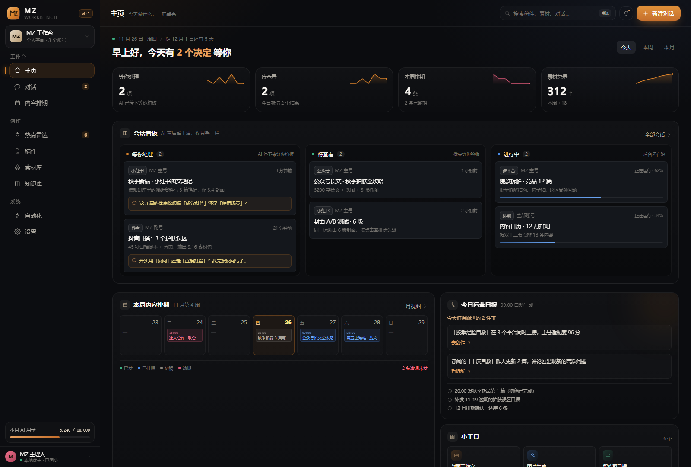
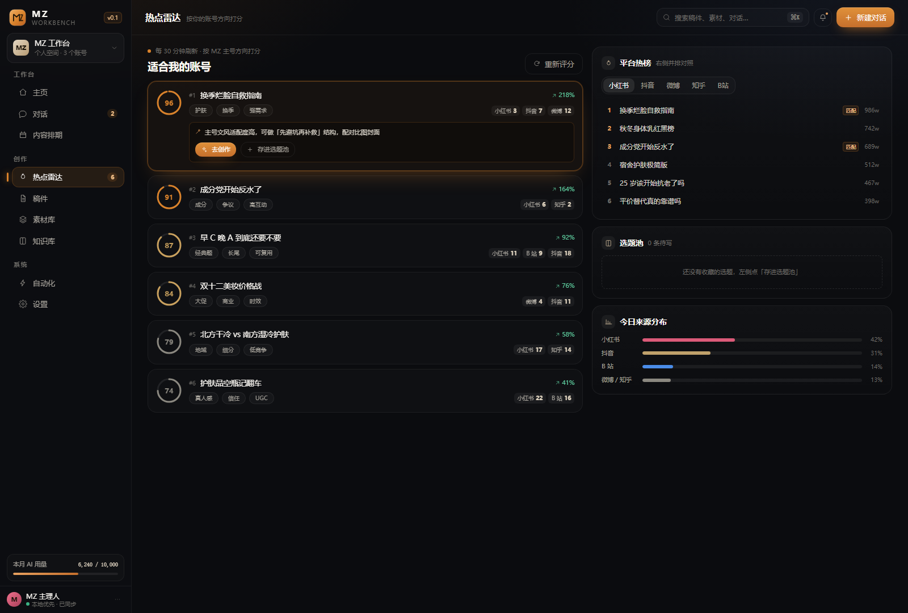
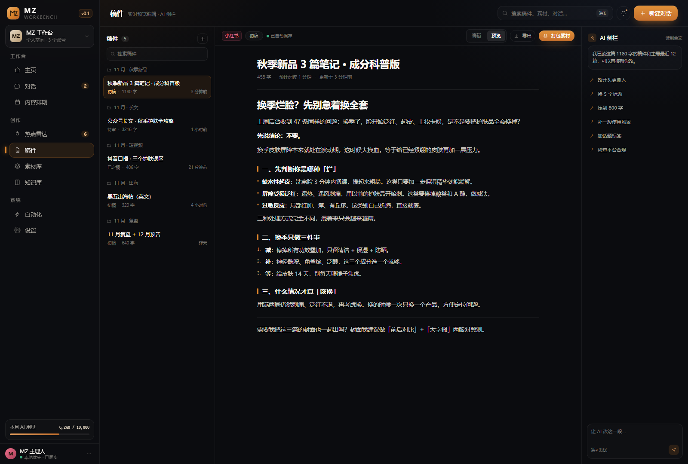
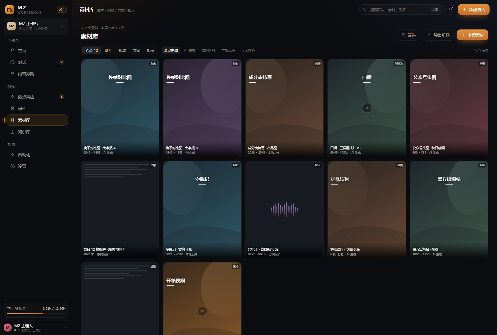
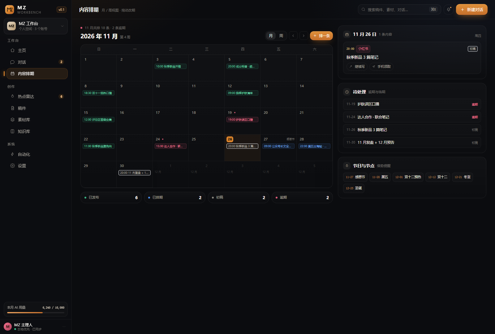

<p align="center">
  
</p>

<h1 align="center">MZ · AI 内容运营工作台</h1>

<p align="center">
  选题、写稿、素材、排期、发布前打包，放在同一个界面里。
  <br />
  React 18 · TypeScript · Vite · Tailwind CSS · 纯前端 · 本地优先
</p>

<p align="center">
  
  
  
</p>

---

## 这是什么

**MZ** 是一个个人向的内容运营工作台前端。它把自媒体日常里最分散的几件事——找选题、写稿、管素材、排期、发布前打包——收进一个界面，并且让每个账号的定位、文风、已发内容作为「长期记忆」被反复复用。

产品结构参考了开源项目 [Beav（原 RedBox）](https://github.com/Jamailar/Beav) 的思路：**不是又一个聊天框，而是素材库 + 运营工作台**。MZ 是独立实现的 Web 版复刻，不含 Beav 的任何源码。

> 当前为交互原型：数据是内置的演示数据，AI 能力以界面流程呈现，尚未接入真实模型与爬虫。

## 页面一览

| 页面 | 做什么 |
| --- | --- |
| **主页** | 三栏会话看板（等你处理 / 待查看 / 进行中）+ 本周排期 + 今日运营日报 + 小工具 + 账号记忆 |
| **对话** | 说目标就开工；执行步骤可折叠，需要你拍板时弹出问题卡片，产物直接挂在对话里 |
| **内容排期** | 月视图日历，按状态着色（已发 / 已排期 / 初稿 / 逾期），右侧当日详情与节日节点 |
| **热点雷达** | 按账号方向打分的候选选题 + 各平台热榜并排对照 + 选题池 |
| **稿件** | 文件夹式稿件列表、实时预览编辑器、AI 侧栏（改开头 / 换标题 / 压字数 / 合规检查） |
| **素材库** | 图片 / 视频 / 文案 / 配乐网格，多选、筛选、空格预览、AI 视觉索引 |
| **知识库** | 链接入库、自动转写、爆款拆解（选题内核 / 结构 / 钩子 / 可复用点）、订阅博主 |
| **自动化** | 定时任务开关、执行统计、Agent 接入（Claude Code / Codex / Obsidian） |
| **设置** | 模型接入与 Key 管理、账号空间、本地存储与备份 |

### 主页



### 热点雷达



### 稿件编辑器



### 素材库



### 内容排期



## 本地运行

```bash
npm install
npm run dev      # http://127.0.0.1:5177
npm run build    # 产出 dist/
npm run preview  # 预览构建产物
```

Node 18+ 即可，无后端、无数据库。

## 目录结构

```
mz/
├── index.html
├── public/logo.svg
├── src/
│   ├── App.tsx              # 外壳：侧边栏 + 顶栏 + 视图路由（hash）
│   ├── main.tsx
│   ├── index.css            # 设计令牌与组件类（卡片 / 按钮 / 导航项）
│   ├── data.ts              # 演示数据与类型定义
│   ├── components/
│   │   ├── Icon.tsx         # 内联 SVG 图标集 + Logo
│   │   ├── Sidebar.tsx
│   │   ├── TopBar.tsx
│   │   ├── SessionDrawer.tsx# 会话右侧抽屉（步骤折叠 / 问题卡片）
│   │   └── ui.tsx           # Ring / Sparkline / Tabs / PlatformTag 等
│   └── views/
│       ├── Home.tsx  Hot.tsx  Drafts.tsx  Media.tsx
│       ├── Knowledge.tsx  Schedule.tsx  ChatPage.tsx
│       └── Automation.tsx  Settings.tsx
└── docs/screenshots/
```

## 设计约定

- **配色**：深色底 `#0B0C0F`，暖橘主色 `#D9822B`，正文暖白 `#F1ECE3`；状态语义色：已发绿 / 已排期蓝 / 逾期玫红。
- **信息层级**：所有卡片 18px 圆角、1px 低对比描边、渐变填充代替纯色块；不使用重阴影。
- **字号**：标题 19–21px，正文 13–13.5px，元信息 9.5–11px，数字一律 tabular-nums。
- **路由**：hash 路由（`#hot`、`#drafts`…），静态托管可直接深链接。

## 说明

- 本项目仅作产品结构与交互的独立实现，与 Beav 项目及作者无关联，未使用其源码。
- Beav 采用 MIT-NC 许可（禁止商用）；MZ 自身以 MIT 发布，若你打算商用，请自行评估相关风险。

## License

[MIT](./LICENSE)
