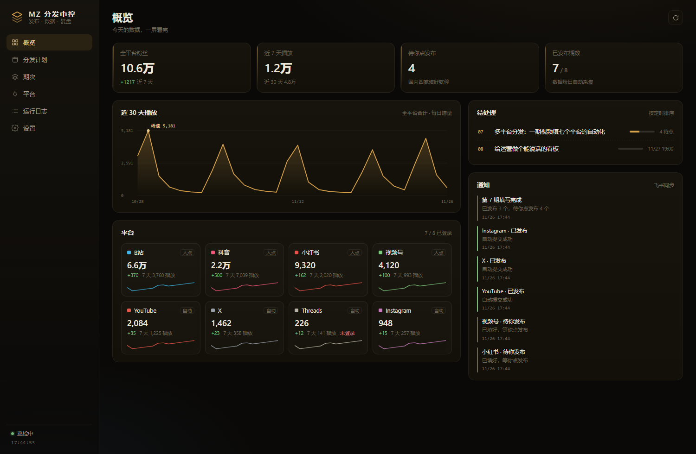

# MZ 分发中控

<p>
  自媒体多平台发布调度与数据监控。跑在自己电脑上的一个小中控：<b>一期视频填七个平台，国内四家的最后一下由你点</b>，数据每天自动回来。
  <br />
  Node.js（零依赖） · SQLite 免装（单文件 JSON） · 网页大屏 · 飞书通知
</p>

> 架构参照开源项目 [麦田（mdldm-maitian）](https://github.com/CzzzzzzJ/mdldm-maitian) 的思路独立实现，不含其源码。
> **当前版本跑的是模拟填写驱动**：状态机、分批、防重、取链接、采样、复盘全是真代码，只有「怎么点开平台网页填表」这一步是演的。



## 快速开始

```bash
node src/hub.mjs demo
```

打开 `http://127.0.0.1:8899/?key=mz-demo`。会生成 8 期演示数据（6 期已发 + 2 期待发）和 30 天播放、粉丝曲线，并起一个每 20 秒巡检一次的守护循环。

想亲手看一次状态机跑起来：进「分发计划」，点第 7 期的 **开始填写**。

```bash
node src/hub.mjs seed --force     # 重建演示数据
node src/hub.mjs status 7         # 命令行看某一期
node src/hub.mjs run 7            # 命令行跑一期
node src/hub.mjs sync 7           # 取链接（把「待你发布」变成「已发布」）
node src/hub.mjs review 6         # 单期复盘
node src/hub.mjs daemon           # 常驻巡检
npm test                          # 14 个用例，覆盖状态机与防重
```

## 它管什么

| 环节 | 做什么 |
|---|---|
| 分发计划 | 一期一张卡，八个平台各一个状态；到点自动开跑 |
| 填写 | 分批进平台（`config.batches`），一次传太多会互相抢带宽 |
| 自动 / 人工 | YouTube、X、Instagram、Threads 回读核对后自动提交；B站、抖音、小红书、视频号**填完就停**，等你点 |
| 防重 | 已到位的平台永不再跑；这是整个项目最重要的一条规则 |
| 取链接 | 到点去各平台把链接取回来，回填到这一期 |
| 采集 | 每天采一次播放、点赞、评论、收藏、分享与粉丝；失败保留上次成功数据 |
| 复盘 | 第 1/3/7 天各出一张：平台占比、互动率、与上一期**同龄对比**（第 N 天对第 N 天） |
| 通知 | 开跑、每个平台到位、异常、到点、日报都进通知流；配了 webhook 就同步推飞书 |

## 状态机

平台任务是唯一的事实来源，状态写在 `store.json` 的 `tasks` 里：

```
planned → running → ┬→ published      （自动平台：回读一致后提交）
                    ├→ awaiting_user  （国内四家：填好，等人点）
                    ├→ failed         （表单对不上）
                    └→ not_logged_in  （登录态失效，扫码后补跑）
```

**`LOCKED = filled / awaiting_user / scheduled / published`** —— 落进这四个状态的平台，除非显式 `--force`，一律不再重跑。重复上传是最容易触发平台风控的动作，所以这条比「能不能全自动」重要。

`skip` 的平台（这一期不发）永远是 `skipped`，不参与进度计算。

## 目录

```
src/
  hub.mjs          CLI 入口 + 守护循环
  runner.mjs       执行层：跑一期 / 取链接 / 采样 / 巡检
  state.mjs        状态机与 LOCKED 判定
  metrics.mjs      增长模型、单日增量、复盘与同龄对比
  store.mjs        单文件 JSON 存储（tmp + rename 原子写）
  config.mjs       配置（缺 config.json 时用默认值，不会退出）
  platforms.mjs    平台登记：颜色、登录页、采集权重
  notify.mjs       通知：控制台 + 飞书卡片
  seed.mjs         演示数据
  adapters/
    mock.mjs       模拟填写引擎（当前使用）
    cdp.mjs        真实驱动占位
  web/
    server.mjs     http 服务 + JSON 接口（全站口令）
    index.html  app.js  style.css
tests/state.test.mjs
```

数据落在 `data/store.json`，删掉就回到干净状态（`data/` 与 `config.json` 都不进 git）。

## 接口

| 方法 | 路径 | 说明 |
|---|---|---|
| GET | `/api/overview` | 概览：KPI、30 天曲线、平台卡、待处理、通知 |
| GET | `/api/episodes` | 期次列表 + 进度 |
| GET | `/api/episode?id=` | 单期明细 + 复盘 |
| GET | `/api/platforms` | 平台登录态、粉丝、近 7 天播放 |
| GET | `/api/logs` | 最近 80 条 |
| GET | `/api/state` | 轻量轮询（前端 2.5 秒一次） |
| POST | `/api/run` `/api/sync` | 开跑 / 取链接 |
| POST | `/api/platform` | 启用停用、标记登录态 |
| POST | `/api/settings` | 口令、webhook、巡检间隔 |

所有接口都要口令（`?key=` 或 `x-key` 头），没有一律 401。

## 接入真实平台

模拟驱动只负责「看起来像」，真接要一台**已登录各平台的专用 Chrome**，通过 CDP 驱动，不要用你日常的浏览器（避免和平台登录态、插件打架）。

要改的只有两个函数，接口保持不变：

```js
// src/adapters/cdp.mjs
export async function fill(ep, platformId, { onStep }) {
  // 1. launchChrome()：带 --remote-debugging-port=9333 和独立 --user-data-dir
  // 2. tabs.create 打开平台的 upload 页
  // 3. 传片、传封面、填标题/正文、设定时
  // 4. 回读表单，和 publish.json 比对
  // 5. 自动平台才点提交；国内四家到此为止
  return { state: 'awaiting_user', detail: '已填好，等你点发布', url: null }
}
```

然后把配置切过去：`"driver": "cdp"`。

各平台的坑（来自实战，接真实驱动时会撞上）：

- 成片必须 **faststart**（moov 在文件头），否则小红书报「无视频流信息」、抖音不出表单。
- 视频号的定时可能被平台改掉，表单回读是对的、提交后记成别的时间 —— 取链接时要比对并报警。
- 同一条视频每个平台只传一次，失败先确认没发出去再重跑。
- 国内四家最后一下永远由人点。

## 这一版的边界

- 填写是模拟的，不会真的发到任何平台。
- 没有账号体系，一台机器一份数据，靠 `web.key` 口令保护；要远程访问请自己套隧道（如 cloudflared）。
- 粉丝与播放来自内置模型，同一期同一平台永远算出同一组数，所以复盘可重复。

## License

MIT
